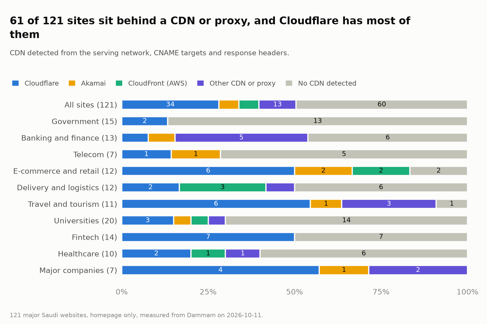
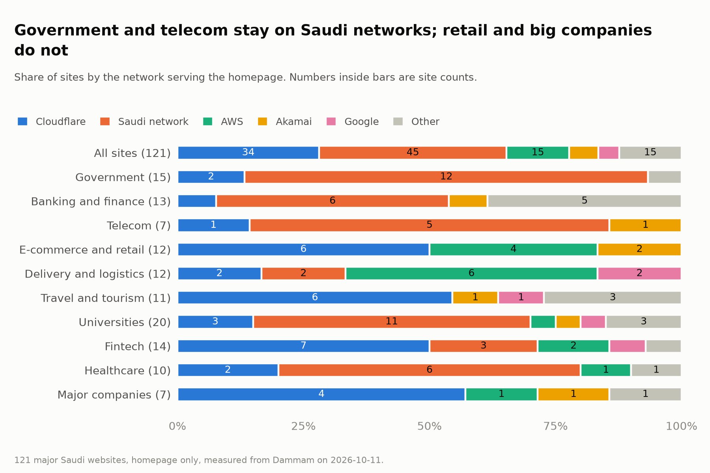
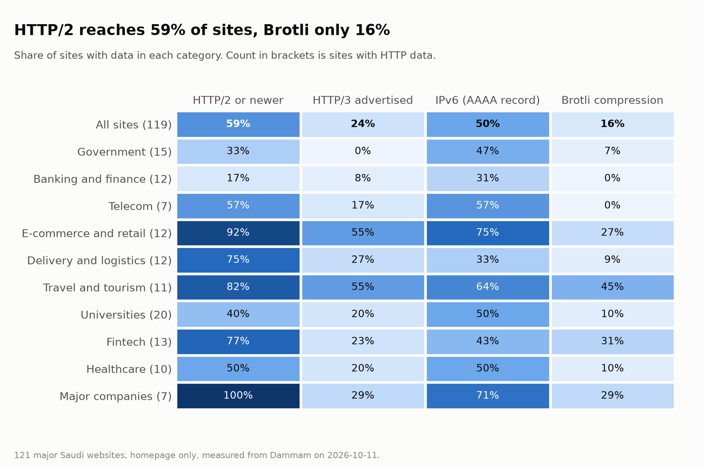
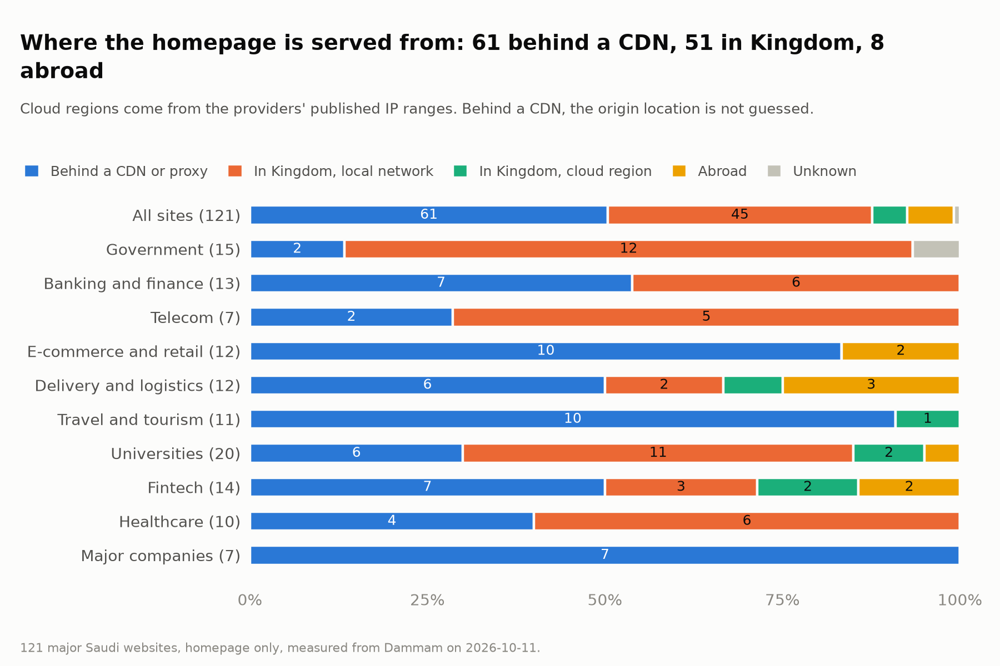
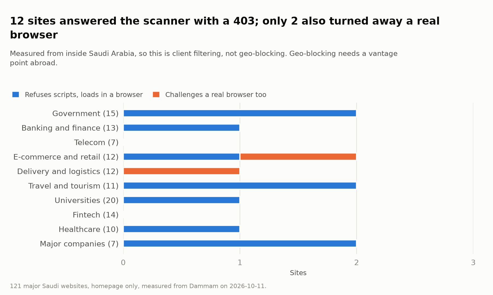
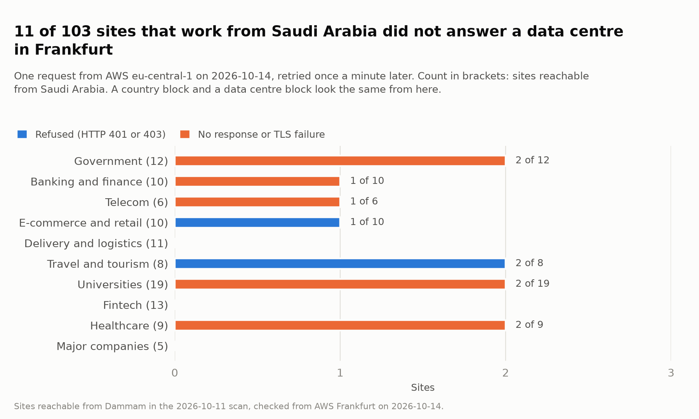
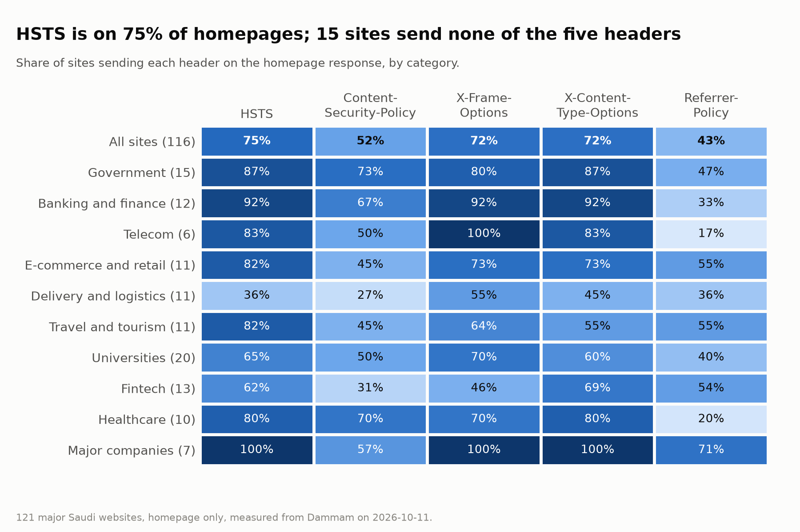
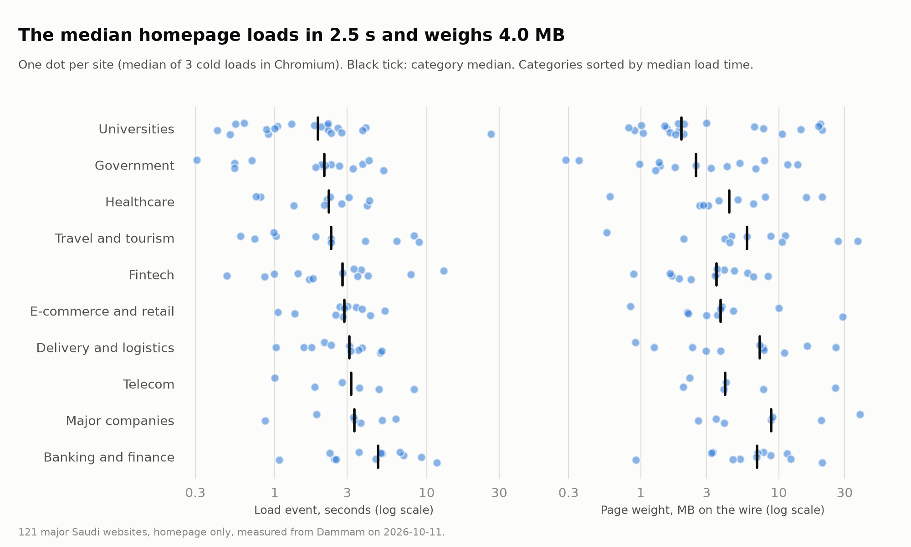

If you build something for users in Saudi Arabia, you make a handful of infrastructure decisions early: host in the Kingdom or abroad, put a CDN in front or not, which cloud, which region. I wanted to know what the country's biggest sites actually chose, so I measured them.

I looked at 121 major Saudi websites across ten sectors: government services, banks, telecoms, e-commerce, delivery, travel, universities, fintech, healthcare and large companies. For each one I checked where its homepage is served from, what sits in front of it, which protocols it speaks, how fast it loads from a Saudi home connection, and whether it can be reached at all from outside the Kingdom.

Most of the numbers are what you would expect. A few are not, and those are what this post is about.

## Half the sites hide behind a CDN, and the split follows the sector

61 of the 121 homepages (50%) are served through a CDN or a DDoS-scrubbing proxy, so the server you connect to is an edge node rather than the site's own infrastructure. Cloudflare fronts 34 of those 61, more than every other provider combined. Akamai, Amazon CloudFront and a handful of security proxies share the rest.

What surprised me was how cleanly this splits by sector. 12 of the 15 government sites are served directly from inside the Kingdom with no CDN in front. Telecoms and universities lean the same way. At the other end, all 7 of the large companies and 10 of the 12 e-commerce and retail sites sit behind a global CDN.

Neither choice is wrong. Serving from inside the Kingdom keeps data and traffic local and is often a regulatory requirement for government services. A global CDN buys you DDoS absorption, caching and modern protocol support with very little effort. But that last point turns out to matter more than I expected.

## HTTP/2 depends almost entirely on who serves you

HTTP/2 has been the default for most of the web for years, so I expected it everywhere. Overall, 70 of 119 sites (59%) support it. That average hides two very different groups:

- **Behind a CDN:** 54 of 60 sites support HTTP/2 (90%).
- **Served directly from Saudi networks:** 6 of 45 sites support it (13%).

The CDN sites get HTTP/2 because the CDN provides it at the edge, whatever the origin server does. Sites served directly from local infrastructure mostly still speak HTTP/1.1 only. I double-checked five of them with `curl --http2`: four refused HTTP/2 during the TLS handshake. The fifth accepted it, which exposed a quirk in my own scanner's HTTP client, and the numbers above are corrected for it.

It is a gap with a cheap fix. HTTP/2 is usually a configuration change on the web server or, more often for these sites, on the load balancer that terminates TLS in front of it. For pages that load a hundred or more resources, which is typical here (the median homepage makes 108 requests), multiplexing those requests over one connection makes a real difference.

If you host in the Kingdom without a CDN, check what your load balancer negotiates. You may be serving HTTP/1.1 without knowing it.

## The cloud regions are here. Almost nobody runs on them yet

Saudi Arabia has had in-Kingdom regions from several global clouds for a while: Google Cloud in Dammam, Oracle in Jeddah and Riyadh, Alibaba Cloud and Huawei Cloud in Riyadh. So I checked how many of these sites run on them.

The answer is 6 of 121:

- 3 on Google Cloud's Dammam region
- 2 on Alibaba Cloud in Riyadh
- 1 on Oracle's Jeddah region

The two Alibaba Cloud sites are placed in Riyadh by IP geolocation, because Alibaba publishes no per-region IP list. The other four come from the providers' published IP ranges.

By comparison, 45 sites are served directly from Saudi networks: telecom operators, local data centres and organisations' own address space. And 8 sites are served directly from cloud regions abroad, most often AWS in Ireland.

Two caveats keep this honest. First, the 61 sites behind a CDN are excluded, because a CDN hides where the origin really lives; some of them may well run in an in-Kingdom region. Second, AWS and Azure did not list a Saudi region in their published IP ranges when I ran this, so none of these sites could have been on one.

Still, the gap between "the regions exist" and "the big sites use them" is wide. Most of the Kingdom's major sites that run locally run on local infrastructure, not on the hyperscalers' Saudi regions.

## Who can reach these sites, and who can't

This part matters if you build integrations, monitoring or anything automated around Saudi services.

**Scripts get turned away more often than people.** 12 sites (10%) refused my scanner outright with an HTTP 403, even though it identified itself honestly and asked for nothing but the homepage. Pretending to be Chrome by changing the User-Agent did not help on any of them. When I opened the same sites in a real Chromium browser, 10 of the 12 loaded normally. Only 2 challenged the browser too.

So bot filtering here looks at more than the User-Agent string, most likely at signals such as how the client negotiates its connection or whether it runs JavaScript. If your backend calls a Saudi site's public pages from a server, expect it to be treated very differently from a person on a phone.

**Some sites don't answer outside the Kingdom.** I repeated the check from a cloud server in Frankfurt. Of the 103 sites my scanner could reach from Saudi Arabia, 11 did not work from there:

- 3 refused the request with HTTP 401 or 403.
- 7 never answered.
- 1 presented a certificate that failed validation from Frankfurt, even though the same site validated fine from Dammam.

From the outside, I can't tell whether these sites block foreign countries or block cloud and data-centre addresses. If it's a country block, it also shuts out Saudis travelling abroad. Either way, it shuts out partners calling from cloud servers abroad and, notably, any uptime monitoring service hosted outside the Kingdom. If you run a Saudi service and monitor it from a European or US region, check that your monitor can actually reach it, or you will get false alarms.

## The rest of the numbers, briefly

None of these are dramatic, but together they describe the baseline:

- **Compression:** only 19 of 116 sites (16%) serve the homepage with Brotli, even though the client offered it. 81 use gzip and 16 send the HTML uncompressed.
- **Plain HTTP:** 20 of 121 sites don't answer on port 80 at all, instead of redirecting to HTTPS. Modern browsers mostly try HTTPS first, but older clients, scripts and plain `http://` links simply fail.
- **Security headers:** HSTS is on 75% of homepages and Content-Security-Policy on 52%. 26 sites send all five common security headers; 15 send none of them.
- **TLS:** 71% negotiate TLS 1.3 and the rest TLS 1.2. DigiCert issued 41% of the certificates; Let's Encrypt only 10 of 116.
- **IPv6:** half the sites (61 of 121) publish an IPv6 address.
- **Page weight and speed:** on a home fiber connection in Dammam, the median homepage weighs 4.0 MB and fires its load event at 2.5 seconds. 24 homepages are over 10 MB, and the heaviest is 38.6 MB.

## What this doesn't tell you

- **Homepage only.** Apps, APIs and login portals often run on different infrastructure from the marketing homepage.
- **One vantage point.** Everything except the Frankfurt check was measured from a single home connection in Dammam. Other cities and networks may see different CDN edges and different blocking behaviour.
- **CDNs hide the origin.** For half the sites, I know who serves them but not where they really run.
- **One point in time.** This is a snapshot from October 2026, and sites change.
- **Small groups.** Some sectors have only 7 to 15 sites, so treat per-sector differences as signals, not rankings.

## How I measured it

Everything was passive and limited to what a normal visit does: DNS lookups, one request for each homepage, one TLS handshake, and three page loads in a real Chromium browser for the performance numbers. My client identified itself honestly. I did no port scanning, no vulnerability scanning, no login attempts and no probing beyond the homepage. Sites that refused a script got exactly one retry with a browser User-Agent, and the real browser's result was treated as final.

Hosting was identified from the network that owns each serving IP address. Cloud regions came from the IP ranges that AWS, Google Cloud, Azure, Oracle and Cloudflare publish, and from IP geolocation for Alibaba Cloud and Huawei Cloud, which publish no such lists. CDNs were identified from network ownership, DNS records and response headers. The scan ran on 11 October 2026 from a home fiber connection in Dammam, and the outside check on 14 October 2026 from AWS in Frankfurt.

## The takeaway

If you're deploying for Saudi users, three things from this are worth acting on:

1. **If you serve from local infrastructure, check your HTTP/2.** Most locally served sites in this sample don't have it, and it's usually a configuration change.
2. **The in-Kingdom cloud regions are an option most big sites haven't taken up yet.** Whether they suit you depends on your compliance needs, but they exist.
3. **Test from where your users and your systems actually are.** A site that works from Riyadh may be invisible to a server in Frankfurt, and a site that works in a browser may reject your script.
